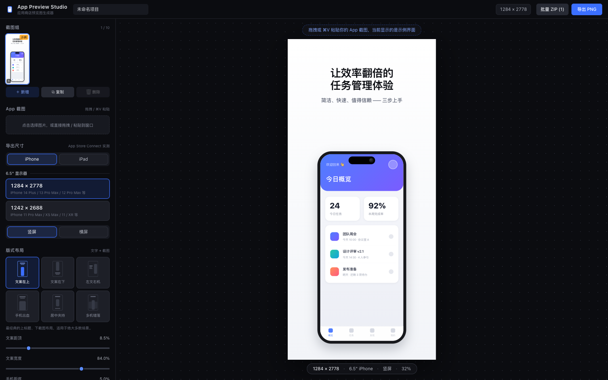
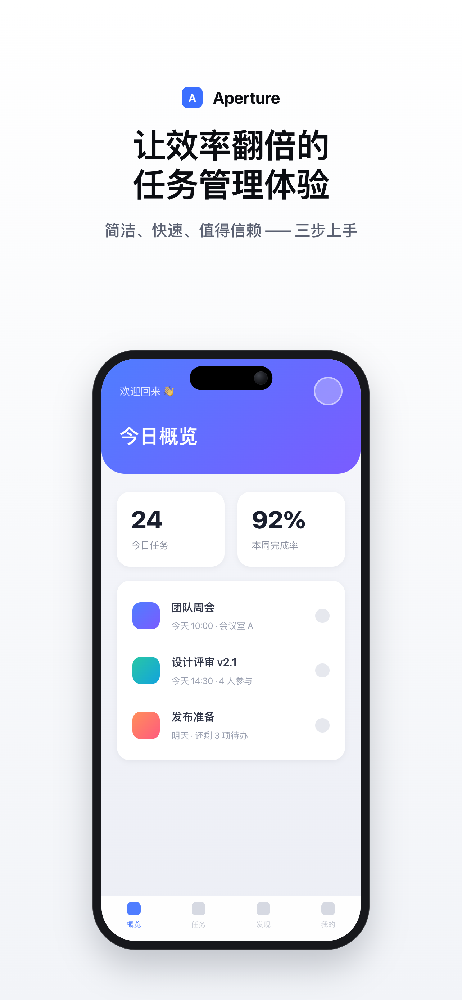
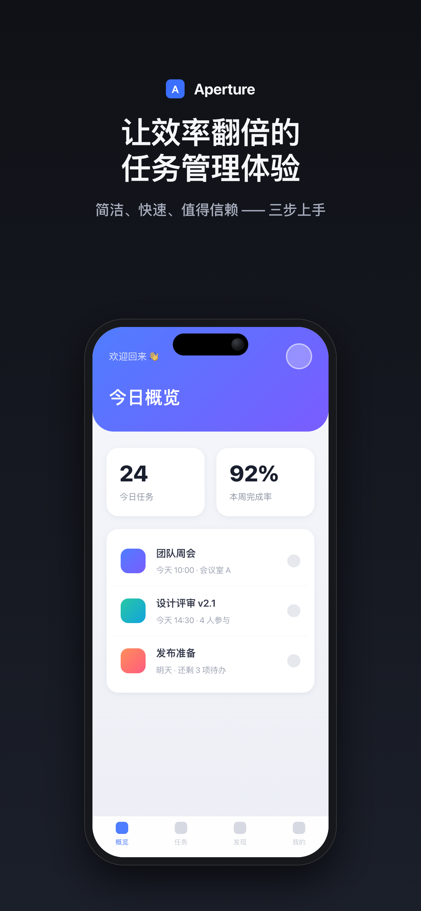
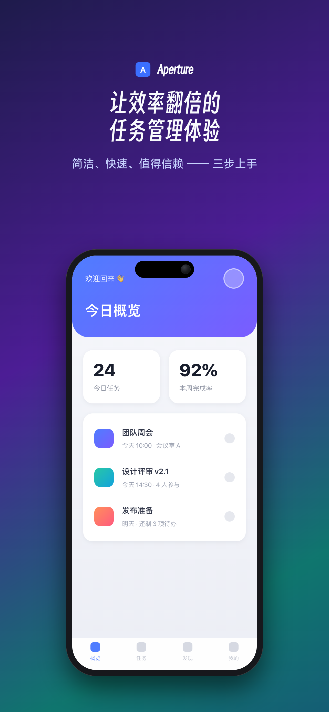

<div align="center">

# 📱 App Preview Studio

**App Store 预览截图生成器**

上传 App 截图 → 选择官方尺寸 → 套用版式 / 手机边框 / 主题 → 一键导出**精确像素**、**不带透明通道**的 PNG

纯前端 · 打开即用 · 数据只保存在你的浏览器

> 🆕 **新增「创意素材」与「图片裁剪」两个工作台**：
> 创意素材覆盖 iOS 27 起 App Store 的**标题图**与**搜索结果图**，内置**安全区实测数据**与**合规检查**；
> 图片裁剪把**已经画好的成品图**按官方比例裁开，一次导出全部尺寸。详见 [设计文档](docs/creative-assets-design.md)。

<p>
  
  
  
  
  
</p>

<p>
  <a href="https://app-preview-studio.kyrieliu.cn">
    
  </a>
</p>



<p>
  
  
  
</p>
<p align="center">
  <sub>同一套文案 × 三种主题：<b>极简白</b> / <b>深色高级</b> / <b>Aurora + 得意黑标题</b> —— 均为真实导出的 1284 × 2778 PNG</sub>
</p>

</div>

---

## ✨ 特色

### 📐 官方尺寸，开箱即用

- **iPhone 6.5"**（1284 × 2778 / 1242 × 2688）与 **iPad 13"**（2064 × 2752 / 2048 × 2732）四档，按 App Store Connect 后台**实测**收敛
- 竖屏 / 横屏一键切换（交换宽高），同档位内自由切换分辨率

### 🎨 版式 · 边框 · 主题

- **6 种版式**：文案在上 / 文案在下 / 左文右机 / 手机出血 / 居中夹持 / 多机错落，间距、宽度、比例全部滑杆微调
- **5 种手机边框**：灵动岛 / 刘海 / Home 键 / iPad 窄边框 / 裸屏圆角 —— 纯 CSS/SVG 自绘，任意分辨率下保持锐利
- **10 套主题**：极简白、深色高级、品牌纯色、Aurora、摄影棚、粗排版海报、马卡龙、neon 辉光、纸感噪点、Mesh 渐变

### 🔤 字体与品牌

- **10 种字体**：系统默认 / 苹方（PingFang SC）/ MiSans / 得意黑 / 阿里巴巴普惠体 / 思源黑体 / Inter / Montserrat / Playfair Display / Bebas Neue
- 主副标题**各自独立**选字体、选字重；字重按钮按字体实际字重**过滤**，切换字体自动钳制到最近可用字重；字体 chips 用本字体渲染实时预览
- **品牌 Logo + 品牌名**展示在每张截图的主标题上方（项目级，全组共用）：圆角（直角 → iOS 图标 → 圆形）、高度、字号滑杆可调

### 🖼 导出与工程

- 隐藏容器按 **1:1 原始像素**渲染后截图，输出**精确尺寸、不带 Alpha 通道**的 PNG（符合 Apple 上架规格）；多张可打包 **ZIP** 批量导出
- 导出末端把图像重绘到 `alpha:false` 画布并用 `toBlob` 编码，剥离 alpha 通道（`toDataURL` 会硬编码输出 RGBA）
- **webfont 按用量内嵌**：字体族 + CSS 字重匹配 + unicode-range ∩ 实际字符，三层过滤后转 base64 注入 —— 导出图在任何机器上渲染一致，不依赖本机字体
- 截图组最多 10 张（App Store 单尺寸上限），可新增 / 复制 / 删除；编辑内容**自动保存**（配置存 localStorage、图片存 IndexedDB），项目可导出 / 导入 JSON 跨设备迁移
- 图片**点击选择 / 拖拽到窗口 / ⌘V 粘贴**均可；左侧表单面板宽度可**拖拽调节**（双击恢复默认）
- **预览可缩放平移** —— 画布自动适应窗口；右下角 `−` / `适应` / `1:1` 控制缩放，`⌘/Ctrl + 滚轮`以指针为锚点缩放，拖拽平移（自动夹在内容边界内，画布不会被拖丢）。切换尺寸时自动回到「适应」档位

### 🎨 创意素材（iOS 27 新坑位）

顶栏下方的切换条在**「App 预览截图」/「创意素材」/「图片裁剪」**三个工作台之间切换，三者数据与持久化完全隔离。

| 坑位 | 比例 | 导出尺寸 |
| :-- | :-- | :-- |
| **标题图** Header | 21:9 | **3840 × 1646**（固定） |
| **标题图** Header | 16:9 | **5244 × 2950**（仅 PNG） |
| **搜索结果图** Search Results | 3:2 | **3840 × 2560** 或 **1920 × 1280** |
| **搜索结果图** Search Results | 16:9 | **5244 × 2950**（仅 PNG） |

去重后共 **5 个尺寸选项**——其中 **5244 × 2950 两个坑位共用**，一份文件可同时填两处
（对应 App Store Connect 的「Use header asset in search results」）。**图片裁剪**工作台复用同一张表。

- **安全区实测内置** —— Apple 从不公布安全区像素值，本工具的数值由**解析 Apple 官方 Sketch 模板**得到（3840×1646 → 1646×661；3840×2560 → 2168×1030；5244×2950 → 1402×962，均经对称性校验）
- **排版密度跨尺寸一致** —— 字号以**安全区宽度**为基准，因此五个尺寸下每行能放的字数完全相同；面板的 px 读数即真实渲染值
- **安全区检查** —— 画布上标出安全区并对越界元素描红，面板逐项列出「超出 Npx（方向）」，顶栏实时徽章；主体图默认不检查（出血是设计意图）
- **合规检查** —— 实时扫描文案中的价格 / 折扣 / 网址 / 版权符号 / 奖项榜单等 Apple 明令禁止的内容并给出改写建议
- **4 种横幅版式**（居中主张 / 左文右图 / 上文下图 / 满幅图底），几何**以安全区为基准**，因此版式本身不会越界；「上文下图」会实测文案高度自动避开图文重叠；每个版式都标注了**用图 / 纯排版**，选版式时就能看出它会不会展示主体图
- **变体组**最多 12 个 —— 呼应 Asset Library：预先备好多套（如夏季版 / 冬季版），审核通过后上线直接替换，无需提交新版本
- **旧存档自动升级** —— 存档带版本号，基准变化时按**精确换算**迁移（不是猜：v1 的语义是确定的，能反解出渲染像素），打开时看到的画面与升级前逐像素一致
- 主体图**可选**：Apple 允许纯品牌 / 纯排版素材，不上传图片同样合规。上传时若当前版式不展示主体图，会自动切到会展示它的版式，并在画布上给出提示与一键切换

### ✂️ 图片裁剪

**已经有成品图、只是需要按官方比例裁开**时用这个工作台 —— 它不产出设计，只做裁剪，因此面板里没有主题 / 文案 / 品牌，也没有任何诱导你改这些的入口。

- **画框锁定官方比例，图片可拖拽 / 缩放** —— 画框随坑位与尺寸切换（21:9 / 16:9 / 3:2），源图在框内拖动构图、滚轮缩放；`⌘/Ctrl + 滚轮`才是缩放预览，两层缩放互不干扰
- **构图存相对量，切尺寸自动按比例保留** —— `zoom` 是「相对刚好铺满的倍数」、`offset` 归一化到多余空间。在 21:9 上「看右边」，切到 3:2 仍然是「看右边」，不需要重裁四遍
- **一键全部尺寸** —— 按每个画框的比例**分别重排**同一份构图，一次产出 4 个合法文件（ZIP），每张都已剥离 alpha 通道
- **画质告警** —— 实时量化「这张构图实际用到的源图像素够不够画框用」，会糊就直接说明会被放大多少倍。这是裁剪最隐蔽的失败模式：界面上看着完全正常，上传后才被判画质不合格
- **批量导入**最多 12 张，每张各自记忆构图；安全区**仅作预览参考**（叠加层绝不进导出）

## 🚀 快速开始

**🌐 在线即开即用 → [app-preview-studio.kyrieliu.cn](https://app-preview-studio.kyrieliu.cn)**（纯前端应用，数据仍只保存在你的浏览器，不经过任何服务器）

克隆到本地运行：

```bash
git clone https://github.com/KKKyrie/app-preview-studio.git
cd app-preview-studio
npm install
npm run dev        # http://localhost:5173
```

```bash
npm run build      # vue-tsc 类型检查 + 产物构建（dist/）
npm run preview    # 预览构建产物
```

## 📐 导出尺寸

### App 预览截图

| 设备 | 尺寸（px） | 对应机型（部分） |
| :-- | :-- | :-- |
| iPhone 6.5" | **1284 × 2778** | iPhone 14/13/12 Pro Max、15/16 Plus、16 Pro 等 |
| iPhone 6.5" | **1242 × 2688** | iPhone 11 Pro Max、XS Max、11、XR 等 |
| iPad 13" | **2064 × 2752** | iPad Pro 13"（M4）等 |
| iPad 13" | **2048 × 2732** | iPad Pro 12.9"（M1–M2）等 |

> 横屏 = 交换宽高；同档位内 App Store 会自动缩放，每个尺寸组最多 10 张。

### 创意素材（iOS 27 / iPadOS 27+）

| 画布 | 用于坑位 | 安全区 | 来源 |
| :-- | :-- | :-- | :-- |
| **3840 × 1646** | 标题图 | 1646 × 661 @ (1097, 493) | 实测 |
| **3840 × 2560** | 搜索结果图 | 2168 × 1030 @ (836, 765) | 实测 |
| **1920 × 1280** | 搜索结果图 | 1084 × 515 @ (418, 383) | 推导（3:2 等比） |
| **5244 × 2950** | **两个坑位共用** | 1402 × 962 @ (1921, 660) | 实测 |

> 5244 × 2950 的安全区仅占画布 8.7% 且垂直偏上 334px，是所有尺寸中最难排的。

## 🧪 验证脚本

需要本机安装 Chrome，且 `npm run dev` 正在运行：

| 命令 | 覆盖内容 |
| :-- | :-- |
| `npm run verify:export` | 单张导出 → 校验 PNG 像素尺寸**与 alpha 通道** |
| `npm run verify:workflow` | 批量 ZIP 导出 + 刷新后项目状态恢复 |
| `npm run verify:fonts` | 字体选择 + 品牌 Logo / 名字（导出、刷新恢复、视觉产物） |
| `npm run verify:panel` | 左侧面板拖拽调宽（默认 / 最小 320、双击复位、刷新保留） |
| `npm run verify:creative` | 创意素材工作台：模式切换 / 坑位尺寸 / alpha / 安全区告警 / 合规命中 / 持久化隔离 / v1→v2 存档迁移（55 项） |
| `npm run verify:crop` | 图片裁剪工作台：裁剪几何 / 双层缩放 / 夹紧 / 画质告警 / 一键全部尺寸 ZIP / 导出像素级无叠加层（59 项） |
| `npm run capture:styles` | 6 布局 × 5 边框 × 10 主题 对比图 contact sheet |
| `npm run docs:capture` | 重新生成本 README 的界面截图与主题样张（`docs/`） |

## 🔤 字体与授权

- **苹方 PingFang SC**：Apple 系统字体，随 macOS / iOS 分发（仅本机渲染，不内嵌）
- **MiSans**（小米）、**得意黑 Smiley Sans**、**阿里巴巴普惠体**、**思源黑体 Noto Sans SC**、**Inter**、**Montserrat**、**Playfair Display**、**Bebas Neue**：均为免费商用 / SIL OFL 开源字体
- 得意黑与普惠体已按 **GB2312 + ASCII 子集化**后随包分发（`src/assets/fonts/`），其余走 npm 字体包由 Vite 处理
- 「腾讯字体」为腾讯品牌定制字体（Monotype），不可自由分发，**未收录**

## 🛠 技术栈

- **框架**：Vue 3.5 · TypeScript · Vite 8 · Tailwind CSS 4 · Pinia
- **导出**：modern-screenshot（1:1 渲染 + 字体内嵌注入）· fflate（ZIP 打包）
- **验证**：puppeteer-core 无头 Chrome 驱动全流程

导出管线：TreeWalker 收集画布实际用字 → 按 CSS Fonts 规范挑选字重 → unicode-range 与实际字符求交 → `url(...)` 转 base64 → 强制 `document.fonts` 就绪后截图。

## 📁 目录结构

```
src/
  constants/
    sizes.ts                # App Store Connect 实测截图尺寸表
    placements.ts           # 创意素材坑位 + 尺寸 + 安全区（解析 Apple Sketch 模板实测）
  data/
    {layouts,frames,themes,fonts}.ts   # 注册表：版式 / 边框 / 主题 / 字体
    bannerLayouts.ts        # 横幅版式（几何以安全区为基准）
    compliance.ts           # Apple 素材内容规则（价格 / 网址 / 版权 / 奖项）
  stores/
    project.ts              # 截图项目状态（独立 localStorage key）
    creative.ts             # 创意素材项目状态（独立 key，与截图互不覆盖）
    crop.ts                 # 图片裁剪项目状态（独立 key，无品牌 / 无文案）
    mode.ts                 # 工作台模式（三档）
    assetStore.ts           # 共享面板用的 store 门面
  composables/
    useExport.ts            # 1:1 渲染导出 / 批量 ZIP / 字体内嵌 / alpha 剥离
    usePersistence.ts       # localStorage + IndexedDB 自动保存（三个工作台各一份）
    useImageUpload.ts       # 拖拽 / 粘贴上传（按工作台分发）
    useCropImport.ts        # 裁剪图片导入（点击 / 拖拽 / 粘贴三条路径共用）
    useCropQuality.ts       # 裁剪画质徽章（画布与顶栏同一份文案）
    usePanelWidth.ts        # 左侧面板拖拽调宽（最小 = 默认 320px）
    useSafeArea.ts          # 安全区越界测量
    useAspectRatio.ts       # 主体图宽高比异步加载
    useStageViewport.ts     # 预览缩放 / 平移（两个画布工作台共用）
  utils/
    cropGeometry.ts         # 裁剪几何：cover / 归一化偏移 / 夹紧（纯函数）
  assets/
    fonts.css               # 随包子集化字体 @font-face（得意黑 / 普惠体）
    fonts/                  # GB2312+ASCII 子集化 woff2（pyftsubset 生成）
  components/
    ModeSwitch.vue          # 工作台切换条（含实时安全区 / 合规 / 画质徽章）
    stage/                  # 画布渲染（内部仅内联样式，保证导出一致）
      ScreenshotCanvas.vue  # 截图画布
      CreativeCanvas.vue    # 创意素材画布
      CropCanvas.vue        # 裁剪画布（画框锁定比例，源图可平移缩放）
      SafeAreaOverlay.vue   # 安全区可视化（仅预览，不进导出）
    panels/                 # 左侧功能面板
    ui/                     # 面板基础组件
scripts/                    # 无头浏览器验证 / 配图生成脚本
docs/                       # README 配图 + 创意素材设计文档
```

## 📝 备注

- 截图尺寸表以 **2026-09 App Store Connect** 后台实际要求为准，并对照 [Apple 官方截图规格](https://developer.apple.com/help/app-store-connect/reference/app-information/screenshot-specifications) 核验
- 创意素材尺寸以 [Apple 官方 Creative assets specifications](https://developer.apple.com/help/app-store-connect/reference/app-information/creative-assets-specifications) 为准；**安全区数值由本工具解析 Apple 官方 Sketch 模板实测得到**（Apple 不公布像素值），并经三画布对称性校验
- 3:2 规格给的是 **区间**（1920×1280 ~ 3840×2560）而非枚举，故只提供两个端点值，不开放自定义；5244 × 2950 官方明确仅支持 `.png`，本工具统一导出 PNG（三处格式均合法，且中文小字无压缩伪影）
- 素材内容需满足 Apple 的 4+ 内容分级；合规检查基于[官方最佳实践](https://developer.apple.com/app-store/asset-best-practices/)的明文条款，实际审核尺度可能更严
- 所有数据只保存在本机浏览器，应用无任何后端、无网络请求
